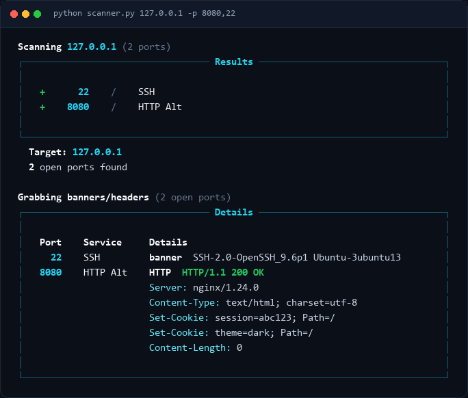

<div align="center">

# Port Scanner

**A fast, async port scanner with banner grabbing and HTTP header inspection.**



[](https://www.python.org/)
[](https://github.com/Textualize/rich)
[](LICENSE)

</div>

---

## Features

- **Fast** — scans 256 ports and probes 100 services concurrently.
- **Dual-stack aware** — resolves every address and falls back across IPv4 and IPv6, so `localhost` works on either family.
- **Banner and header inspection** — grabs SSH, FTP, SMTP and other service banners, plus HTTP status lines and headers.
- **TLS support** — unverified contexts for self-signed and internal certificates.
- **JSON export** — machine-readable output with duplicate headers preserved.
- **Robust output** — UTF-8 safe, atomic file writes, and clear command-line validation.

## Install

Requires **Python 3.9+**.

```bash
pip install -r requirements.txt
```

Or install the project to get the `portscan` command:

```bash
pip install -e .
```

## Usage

```bash
python scanner.py <url>

# or, after an editable install
portscan <url>
```

### Options

| Flag | Description | Default | Example |
|------|-------------|---------|---------|
| `-p`, `--ports` | Ports to scan (comma-separated or range) | common ports | `-p 80,443,8080` or `-p 1-1000` |
| `-t`, `--timeout` | Per-connection timeout in seconds (must be > 0) | `1.0` | `-t 0.5` |
| `--probe-timeout` | Banner/header read timeout in seconds (must be > 0) | `2.0` | `--probe-timeout 3` |
| `--no-banner` | Skip banner grabbing and header inspection | off | `--no-banner` |
| `-o`, `--json` | Write JSON to `FILE` (`-` for stdout) | off | `--json scan.json` |
| `-h`, `--help` | Show help and exit | | |

`-p` accepts single ports, comma-separated lists, and ranges. Empty entries,
reversed ranges (`443-80`), out-of-range ports, and malformed values are
rejected with a clear error; duplicate ports are collapsed.

## How it works

1. **Resolve** — the hostname is resolved once, and every address it returns is kept.
2. **Scan** — each port is opened with a bounded connection timeout. A completed TCP handshake marks the port open.
3. **Probe** — open ports are probed in parallel:
   - Known HTTP ports receive a `GET / HTTP/1.1` request.
   - Other ports are read for a service banner; an `HTTP/` banner triggers an HTTP request.
   - Silent ports are retried once with an HTTP request, so HTTP services on non-standard ports are still detected.
4. **Report** — results are printed as a table and optionally exported to JSON.

Probing is fast: 256 ports are scanned at a time, probes run 100 at a time, DNS
is resolved once per scan, and banner reads stop after 0.2s of inactivity, so
silent ports do not stall the scan.

### Networking notes

- **DNS and IPv6** — every address returned by the resolver is tried, so
  dual-stack targets work even when only one family is reachable. Scanning
  `localhost` finds IPv4-only services instead of stopping at `::1`.
- **Internationalised hostnames** — IDN targets are IDNA-encoded for DNS, SNI,
  and the `Host` header (for example, `münich.de` becomes `xn--mnich-kva.de`).
- **Output encoding** — non-ASCII banners and headers are written as UTF-8.
  On Windows consoles, the standard streams are reconfigured to UTF-8 with
  replacement characters, so a single non-cp1252 byte cannot abort output.

## JSON export

```bash
# Write results to scan.json (parent directories are created automatically)
python scanner.py example.com --json scan.json

# Print JSON to stdout (only JSON is written, so it can be piped)
python scanner.py example.com -p 80,443 --json -
```

Output shape:

```json
{
  "target": "example.com",
  "scanned_at": "2026-11-11T21:13:20+00:00",
  "open_port_count": 2,
  "open_ports": [
    {
      "port": 80,
      "service": "HTTP",
      "banner": null,
      "http_status": "HTTP/1.1 200 OK",
      "headers": [
        {"name": "Server", "value": "cloudflare"},
        {"name": "Content-Type", "value": "text/html"}
      ],
      "error": null
    }
  ]
}
```

Repeated headers are preserved: `headers` is a list of `{name, value}` objects,
so `Set-Cookie`, `WWW-Authenticate`, `Link`, and similar headers are not
collapsed.

## Examples

```bash
# Scan common ports
python scanner.py https://example.com

# Scan specific ports
python scanner.py http://scanme.nmap.org -p 22,80,443

# Scan a range with a custom timeout
python scanner.py example.com -p 1-1000 -t 0.5

# Find open ports without probing banners/headers
python scanner.py example.com --no-banner

# Export results to a nested path
python scanner.py example.com --json reports/example.com.json
```

## Security notes

- TLS certificate verification is disabled by default so self-signed and
  internal certificates do not fail probes. Do not rely on these probes for
  trust decisions.
- Only scan systems you own or have explicit permission to test. Port scanning
  can be disruptive and may violate laws or acceptable-use policies.

## License

Released under the [MIT License](LICENSE).